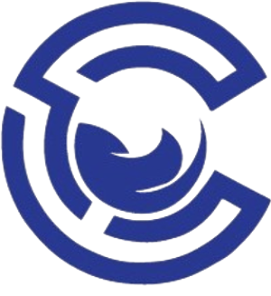
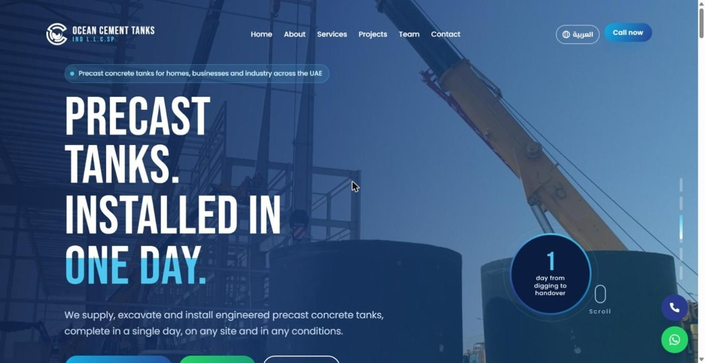
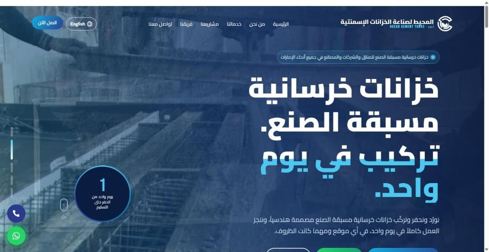
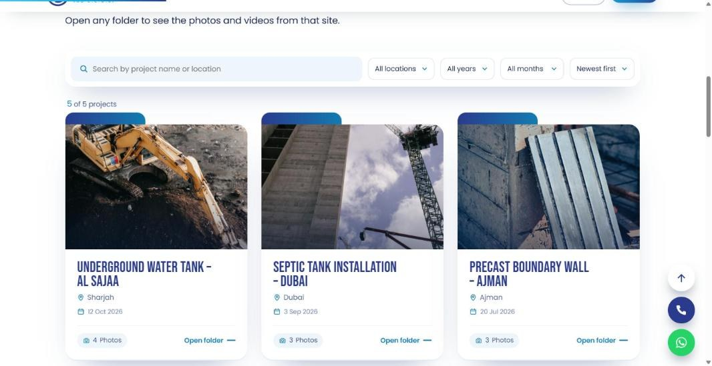
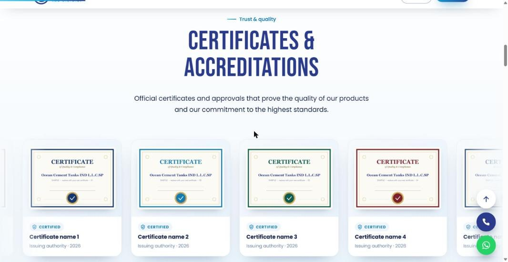
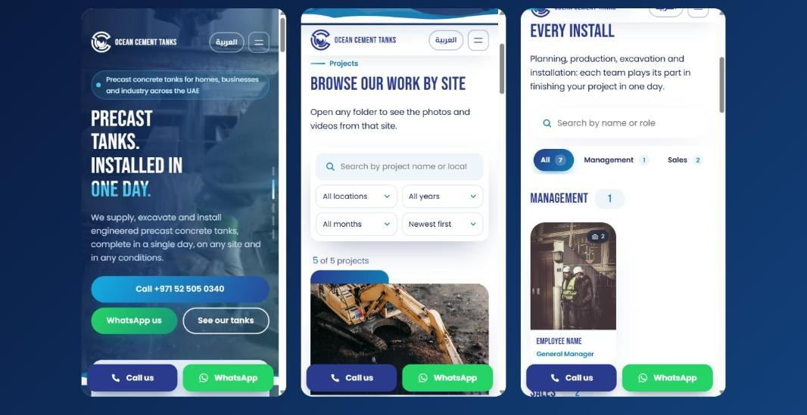

<div align="center">



# Ocean Cement Tanks — Company Website

**A bilingual (English / Arabic), heavily animated WordPress website for a UAE precast-concrete tank manufacturer.**

[**🌐 Live site**](https://oceancementtanks.infinityfreeapp.com/) · [**النسخة العربية**](https://oceancementtanks.infinityfreeapp.com/ar/)




</div>

---

## About the project

**Client:** Ocean Cement Tanks IND L.L.C.SP (المحيط لصناعة الخزانات الإسمنتية ذ.م.م), Al Sajaa, Sharjah, UAE.
**Role:** Designer & developer, end to end: design, front-end, custom plugin, SEO, performance, deployment.

The company manufactures precast concrete water, septic, pump-room and holding tanks and installs them in a single day. The brief was a modern, animated website in **English and Arabic** that the owner can manage himself from the WordPress dashboard, with no code.

## Highlights

| | Feature | Details |
|---|---|---|
| 🌍 | **Fully bilingual EN / AR** | Separate English and Arabic page trees, real RTL layout, Arabic typography, `hreflang` pairs and a one-click language switch. |
| 🎬 | **Video + image hero** | Muted background videos play first, then a slideshow of photos. Videos start only after the page has loaded, are skipped on slow / data-saver connections, and pause when off-screen. |
| 🗂️ | **Projects portfolio for thousands of sites** | Live search (Arabic-aware: ignores diacritics and hamza/taa-marbuta variants), filters by location / year / month, sorting, and a **"Show more"** button backed by a custom REST endpoint. It returns 6 projects at a time, so it stays fast with 7,000+ projects. |
| 📁 | **Project "folders"** | Each project opens a full-screen folder with a photo grid, lightbox and video theater. |
| 👷 | **Team directory** | Unlimited employees grouped by editable departments, each with phone / WhatsApp / email and a profile modal with a photo slider. |
| 🏅 | **Certificates marquee** | Infinite, pause-on-hover carousel of certificates and accreditations, managed from the dashboard (add / edit / delete). |
| 📈 | **Animated counter** | Editable "+7,453 sites completed" counter. |
| 💬 | **Contact form → WhatsApp or Email** | Builds a pre-filled WhatsApp message or `mailto:` email from the form, with no server mail setup needed. |
| 📱 | **Mobile-first polish** | Tested at 360–414 px: sticky bottom action bar, compact header, no horizontal overflow, readable Arabic brand name. |
| 🔎 | **SEO built in** | Per-page meta descriptions, Open Graph / Twitter cards, `HomeAndConstructionBusiness` JSON-LD, clean sitemap, Google Search Console verification field. |
| ⚡ | **Performance** | Page cache with automatic purge on every content change; lazy media; a single minified JS bundle (~36 KB). |

## Screenshots

| English | Arabic (RTL) |
|---|---|
|  |  |

**Projects: search, filters and folders**


**Certificates & accreditations marquee**


**Mobile**


## How it's built

```
.
├── plugin/ocean-core/ocean-core.php   # Custom WordPress plugin (PHP)
│     ├─ Custom post types: projects, team members, certificates
│     ├─ Taxonomies: project locations, team departments
│     ├─ Shortcodes: [oc_projects] [oc_team] [oc_certs] [oc_stat]
│     ├─ REST API:  GET /wp-json/oc/v1/projects  (search, filters, paging)
│     ├─ SEO: meta, Open Graph, hreflang, JSON-LD, sitemap tweaks
│     └─ Cache purge hooks (W3 Total Cache) on every content change
├── theme/
│   ├── css/   # Design system + animations + RTL + responsive layers
│   └── js/    # Vanilla JS: loader, reveals, hero slideshow, modals,
│              #   projects AJAX, team filters, marquee, contact form
├── site-builder/   # Script that builds all pages as native Gutenberg  
│                   #   blocks (EN + AR) from one content file
├── docs/screenshots/
└── package.json    # build: bundle + minify JS, merge CSS, zip plugin
```

- **Theme:** WordPress *Twenty Twenty-Five* block theme, extended with global-styles CSS and custom template parts (header, footer and loader in both languages).
- **No page builder and no jQuery.** Everything is native Gutenberg blocks plus vanilla JavaScript, so the owner edits text and images in the normal block editor.
- **Content model:** projects, team members and certificates are custom post types with meta boxes. The owner adds a project by uploading photos, and it appears in the portfolio automatically.

### Build

```bash
npm install
npm run build      # → dist/bundle.min.js, dist/site.css, dist/ocean-core.zip
```

## Credits

Designed & developed by **Eng Allaith.W67**.
Company name, logo, photos and content belong to Ocean Cement Tanks IND L.L.C.SP and are shown here as a portfolio piece.

---

<div dir="rtl">

## بالعربي

موقع شركة **المحيط لصناعة الخزانات الإسمنتية ذ.م.م** بالشارقة. هو موقع ووردبريس بلغتين، عربي وإنكليزي، وفيه حركات وأنيميشن كتير. صممته وبرمجته من الصفر:

- إضافة (Plugin) خاصة للمشاريع والفريق والشهادات، مع بحث وفلاتر وزر «عرض المزيد» من السيرفر، وبيضل سريع لو صاروا آلاف المشاريع.
- فيديو بخلفية الواجهة الرئيسية بدون صوت، وبعده عرض صور.
- نموذج تواصل بيبعت الرسالة عن طريق الواتساب أو الإيميل.
- تصميم متجاوب مع كل الشاشات، مع دعم كامل للعربي من اليمين لليسار (RTL).
- SEO لمحركات البحث، وكاش، وأداء عالي.

</div>
